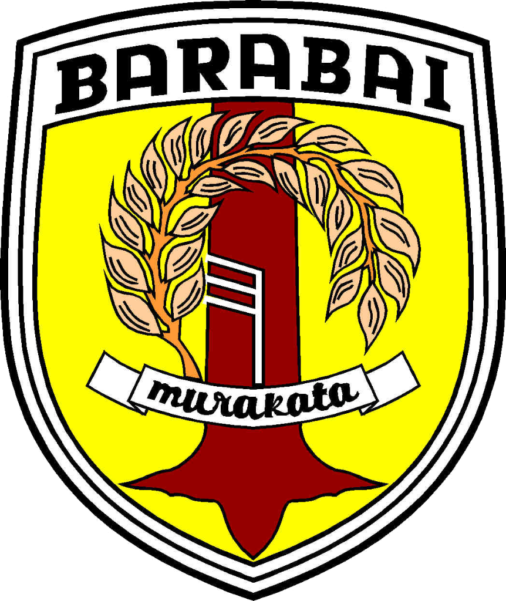

<div align="center">

  

  # 🛡️ LINDUNGMAS HST
  ### Layanan Informasi & Data Perlindungan Masyarakat Terpadu
  **Satuan Polisi Pamong Praja & Pemadam Kebakaran — Bidang Perlindungan Masyarakat**  
  **Pemerintah Kabupaten Hulu Sungai Tengah, Kalimantan Selatan**

  <p align="center">
    <!-- Status & Repository Badges -->
    <a href="https://github.com/hakiem17/lindungmas">
      
    </a>
    <a href="https://github.com/hakiem17/lindungmas/actions/workflows/supabase-keepalive.yml">
      
    </a>
    <a href="https://github.com/hakiem17/lindungmas">
      
    </a>
    <a href="https://github.com/hakiem17/lindungmas/blob/main/LICENSE">
      
    </a>
  </p>

  <p align="center">
    <!-- Framework & Tech Stack Badges -->
    
    
    
    
    
  </p>

  <p align="center">
    <!-- Government Attribution Badges -->
    
    
    
  </p>

  <p align="center">
    Platform operasional resmi berbasis web modern untuk digitalisasi data <b>Satuan Perlindungan Masyarakat (Satlinmas)</b>, inventarisasi <b>Poskamling berbasis GIS</b>, pemantauan <b>Kegiatan Patroli GPS</b>, pencetakan <b>KTA CR80 QR Code</b>, dan pelaporan rekapitulasi situasi dinas ukuran <b>A4</b> se-Kabupaten Hulu Sungai Tengah.
  </p>

</div>

---

## 📑 Daftar Isi
- [🌟 Gambaran Umum Sistem](#-gambaran-umum-sistem)
- [🏛️ Modul & Fitur Nyata Aplikasi](#️-modul--fitur-nyata-aplikasi)
  - [1. Landing Page Publik & Peta Digital HST](#1-landing-page-publik--peta-digital-hst)
  - [2. Dashboard Eksekutif Operasional](#2-dashboard-eksekutif-operasional)
  - [3. Peta Spasial GIS Interaktif (11 Kecamatan & 169 Desa)](#3-peta-spasial-gis-interaktif-11-kecamatan--169-desa)
  - [4. Data Satlinmas (17 Kolom Baku Kemendagri)](#4-data-satlinmas-17-kolom-baku-kemendagri)
  - [5. Data Poskamling (GIS & 8 Sarana Wajib)](#5-data-poskamling-gis--8-sarana-wajib)
  - [6. Kegiatan dan Patroli Lapangan](#6-kegiatan-dan-patroli-lapangan)
  - [7. Cetak Kartu Tanda Anggota (KTA Standar CR80)](#7-cetak-kartu-tanda-anggota-kta-standar-cr80)
  - [8. Laporan Rekapitulasi Situasi Satlinmas (Standar Format A4)](#8-laporan-rekapitulasi-situasi-satlinmas-standar-format-a4)
  - [9. Manajemen Data Master](#9-manajemen-data-master)
  - [10. Manajemen Akun & Hak Akses (RBAC 3 Level)](#10-manajemen-akun--hak-akses-rbac-3-level)
- [🔄 Otomatisasi Supabase Free Tier Keep-Alive](#-otomatisasi-supabase-free-tier-keep-alive)
- [👥 Matriks Hak Akses Peran Pengguna](#-matriks-hak-akses-peran-pengguna)
- [🛠️ Tech Stack & Dependensi](#️-tech-stack--dependensi)
- [💻 Panduan Instalasi & Menjalankan Proyek](#-panduan-instalasi--menjalankan-proyek)
- [🏛️ Atribusi Dinas & Lisensi](#️-atribusi-dinas--lisensi)

---

## 🌟 Gambaran Umum Sistem

**LINDUNGMAS HST** (*Layanan Informasi dan Data Perlindungan Masyarakat Kabupaten Hulu Sungai Tengah*) dikembangkan khusus untuk memfasilitasi kebutuhan operasional **Satuan Polisi Pamong Praja & Pemadam Kebakaran Bidang Linmas Kabupaten Hulu Sungai Tengah, Kalimantan Selatan**.

Aplikasi ini menyatukan pendataan personil Linmas, pos ronda siskamling, dan aktivitas pengamanan lingkungan di **11 Kecamatan** (*Barabai, Batang Alai Selatan, Batang Alai Timur, Batang Alai Utara, Batu Benawa, Hantakan, Haruyan, Labuan Amas Selatan, Labuan Amas Utara, Limpasu, Pandawan*) serta **169 Desa dan Kelurahan**.

```
┌─────────────────────────────────────────────────────────────────────────────┐
│                            ARSITEKTUR LINDUNGMAS                            │
├──────────────────────┬──────────────────────┬───────────────────────────────┤
│ LANDING PAGE PUBLIK  │ SISTEM AUTENTIKASI   │ DASHBOARD UTAMA & OPERASIONAL │
│ • Informasi Terbuka  │ • Login NIP/NIK/Reg  │ • Admin Satpol PP Kabupaten   │
│ • Peta Digital HST   │ • Supabase Auth Live │ • Operator 11 Kecamatan       │
│ • Cakupan Wilayah    │ • Validasi RBAC      │ • Portal Mandiri Anggota      │
└──────────────────────┴──────────────────────┴───────────────────────────────┘
```

---

## 🏛️ Modul & Fitur Nyata Aplikasi

### 1. Landing Page Publik & Peta Digital HST
* **Header Kedinasan Glassmorphism**: Dilengkapi identitas resmi Pemerintah Kabupaten Hulu Sungai Tengah dengan navigasi *Scroll Spy* mengambang (*Beranda, Peta Digital, Fitur Layanan, Cakupan Wilayah, Kontak*).
* **Peta Spasial Terbuka**: Warga dan aparatur dapat mengeksplorasi peta interaktif Kabupaten HST langsung dari halaman muka tanpa harus masuk sistem terlebih dahulu.
* **Filter Pin & Poligon**: Menampilkan layer titik Poskamling (📻), Patroli Lapangan (🚓), dan Personel Satlinmas (🛡️) dengan filter cepat kecamatan dan desa.
* **Statistik Transparansi Publik**: Ringkasan data personil terdata, pos ronda terpetakan, dan cakupan wilayah secara *real-time*.

### 2. Dashboard Eksekutif Operasional
* **4 Indikator Utama (KPI Cards)**:
  1. *Total Personel Satlinmas* (Anggota terdata & aktif 17 kolom baku).
  2. *Data Poskamling* (Pos ronda aktif berkoordinat GIS).
  3. *Kegiatan Patroli* (Laporan patroli lapangan terkunci koordinat GPS).
  4. *Cakupan Wilayah* (11 Kecamatan & 169 Desa/Kelurahan se-HST).
* **Pintasan Cepat Menu Operasional**: Akses satu-klik ke formulir Satlinmas, Poskamling, Lapor Patroli, dan Cetak KTA.
* **Sebaran Sarana per Kecamatan**: Peringkat keaktifan pos ronda, patroli, dan linmas di 11 kecamatan dengan gradasi warna informatif.
* **Kesiapan 8 Sarana Poskamling**: Diagram persentase kelengkapan sarana pos ronda se-kabupaten.
* **Log Audit Trail**: Pencatatan riwayat aksi penting (*Tambah, Edit, Hapus, Verifikasi*) untuk pengawasan pimpinan dinas.

### 3. Peta Spasial GIS Interaktif (11 Kecamatan & 169 Desa)
* **Layer Poligon Kecamatan (`map.json`)**: Memetakan seluruh batas 11 kecamatan dengan kalkulasi kepadatan data (indeks warna pekat untuk wilayah aktif).
* **Layer Poligon Desa (`desa_hst.geojson`)**: Memuat batas poligon lengkap 169 desa/kelurahan. Mengklik nama desa langsung memperbesar (*fitBounds*) ke wilayah desa tersebut.
* **Tombol Cepat "Fokus Kab. HST"**: Mengunci dan mengembalikan orientasi kamera peta ke batas batas resmi Kabupaten Hulu Sungai Tengah.
* **Legenda Responsif**: Dilengkapi tombol toggle legenda adaptif yang ramah layar smartphone/tablet agar tidak menghalangi tampilan peta.

### 4. Data Satlinmas (17 Kolom Baku Kemendagri)
* **Formulir 17 Kolom Baku**: No. Registrasi KTA, NIK 16 digit, Nama Lengkap, Tempat & Tanggal Lahir, Jenis Kelamin, Alamat, Kecamatan, Desa/Kelurahan, Golongan Darah, Status Perkawinan, No. HP, Jabatan/Regu, dan Keterangan.
* **Manajemen Pas Foto & Berkas SK**: Unggah pas foto berseragam dinas dan arsip digital Surat Keputusan (SK) Bupati/Camat.
* **Penyaringan Wilayah Berjenjang**: Memfilter data linmas berdasarkan kecamatan binaan dan desa penugasan.
* **Pencarian Cepat & Ekspor**: Pencarian instan berdasarkan NIK, nama, atau nomor registrasi anggota.

### 5. Data Poskamling (GIS & 8 Sarana Wajib)
* **Perekaman Koordinat Titik GIS**: Input presisi lintang (*latitude*) dan bujur (*longitude*) pos ronda dengan validasi peta satelit.
* **Identitas Pos**: Nama Poskamling, nomor RT/RW, desa/kelurahan, kecamatan, nama ketua pos ronda, dan nomor kontak WhatsApp aktif.
* **Kondisi Fisik & Operasional**: Status bangunan (*Permanen, Semi Permanen, Kayu*) serta kondisi fisik (*Baik, Rusak Ringan, Rusak Berat*).
* **Inventarisasi 8 Sarana Wajib Poskamling**:
  1. *Kentongan Kayu / Bambu*
  2. *Buku Mutasi Tamu / Penjagaan*
  3. *Senter LED Sorot Lapangan*
  4. *Kotak P3K Lengkap*
  5. *Rompi / Jas Hujan Linmas*
  6. *Alat Pemadam / Ember / APAR*
  7. *Radio Komunikasi / HT*
  8. *Lampu Penerangan / Panel Surya*

### 6. Kegiatan dan Patroli Lapangan
* **Input Laporan Cepat Lapangan**: Judul patroli, tanggal & waktu pelaksanaan, petugas pelapor, dan uraian hasil patroli lingkungan.
* **Geotagging GPS Real-Time**: Perekaman koordinat posisi regu patroli saat melakukan pengecekan pos ronda atau giat trantibum.
* **Klasifikasi Situasi Lingkungan**: Status keamanan wilayah (*Aman & Kondusif, Waspada, Butuh Penanganan*).
* **Dokumentasi Foto**: Unggah bukti dokumentasi foto kegiatan regu linmas di lokasi pantau.

### 7. Cetak Kartu Tanda Anggota (KTA Standar CR80)
* **Dimensi Standar Internasional**: Format kartu ID Card ISO/IEC 7810 ID-1 (**CR80: 85.6 mm × 54 mm**) skala 1:1 siap cetak.
* **Sisi Depan (Tampak Muka)**: Logo Pemkab HST, Pas Foto Resmi, Nomor Registrasi Anggota, NIK, Golongan Darah, Jabatan, dan Desa Penugasan.
* **Sisi Belakang (Ketentuan & Validasi)**: Hak & kewajiban anggota, Tanda Tangan Digital Kasatpol PP HST, dan QR Code verifikasi keaslian ke database.
* **Crop Marks (Garis Potong)**: Pilihan garis panduan potong sudut presisi untuk mesin laminasi atau printer ID Card.

### 8. Laporan Rekapitulasi Situasi Satlinmas (Standar Format A4)
* **Kop Surat Dinas Resmi**: Sesuai tata naskah dinas Satpol PP & Pemadam Kebakaran Pemerintah Kabupaten Hulu Sungai Tengah (satu garis pembatas hitam tegas).
* **Penomoran Surat Otomatis**: Format kedinasan `Nomor: 300 / 11.LINMAS / SATPOLPP-HST / [TAHUN]`.
* **Tabel Matriks 11 Kecamatan Se-Kabupaten**:
  * *NO*
  * *KECAMATAN*
  * *PERSONEL LINMAS*: L | P | Total
  * *POSKAMLING*: Baik | Rusak | Total
  * *KEGIATAN PATROLI*: Jumlah giat terlaksana pada bulan terpilih
  * *KETERANGAN*: Status situasi wilayah (*Terkendali / Kondusif*)
* **Ekspor & Cetak Fleksibel**:
  * Tombol **Cetak (A4)** dengan styling `@media print` presisi kertas A4 Portrait.
  * Tombol **Unduh PDF (A4)** via kompilasi `html2canvas` + `jsPDF`.
  * Tombol **Ekspor Excel** format CSV UTF-8.

### 9. Manajemen Data Master
* **Master Wilayah**: Basis data terstruktur 11 Kecamatan dan 169 Desa/Kelurahan di Kabupaten Hulu Sungai Tengah lengkap dengan koordinat pusat pemerintahan.
* **Master Pegawai & Pejabat**: Pengelolaan data NIP, pangkat, golongan, dan jabatan struktural aparatur Satpol PP (termasuk Kepala Satuan).
* **Master Sarana Poskamling**: Standarisasi item fasilitas dan perlengkapan pos ronda lingkungan.

### 10. Manajemen Akun & Hak Akses (RBAC 3 Level)
* **Multi-Tab Akun Terpadu**:
  * *Profil Saya*: Ubah foto profil, data kontak, dan kata sandi mandiri.
  * *Admin Satpol PP (Kabupaten)*: Manajemen akun dinas tingkat kabupaten.
  * *Operator Kecamatan*: Manajemen kredensial petugas operator 11 kecamatan.
  * *Login Akun Linmas*: Pembuatan akun login mandiri anggota linmas dengan *username* NIK 16 digit atau Nomor Registrasi KTA.
* **Tombol Salin Kredensial Instan**: Format teks siap kirim via WhatsApp ke personil bersangkutan.

---

## 🔄 Otomatisasi Supabase Free Tier Keep-Alive

<div align="center">
  
</div>

Supabase paket gratis akan **menjeda proyek (*paused*)** jika tidak menerima aktivitas API selama 7 hari berturut-turut. Repository ini telah dilengkapi mekanisme penjaga keaktifan otomatis:

1. **Script Keep-Alive (`scripts/keep-alive.js`)**:
   Melakukan query database riil (`/rest/v1/satlinmas?select=id&limit=1`) dan pengecekan kesehatan otentikasi (`/auth/v1/health`).
2. **GitHub Actions Workflow (`.github/workflows/supabase-keepalive.yml`)**:
   Berjalan secara otomatis di cloud GitHub setiap **2 hari sekali (cron: `0 4 */2 * *`)**.
   * 100% Gratis dan tidak membutuhkan komputer lokal Anda menyala.
   * Mengatur ulang (*reset*) timer 7 hari Supabase kembali ke nol secara berkala.
   * Dilengkapi tombol manual *workflow_dispatch* di tab Actions GitHub.

---

## 👥 Matriks Hak Akses Peran Pengguna

| Fitur / Modul | Admin Satpol PP (Kabupaten) | Operator Kecamatan (11 Kec) | Anggota Linmas Mandiri |
| :--- | :---: | :---: | :---: |
| **Akses Wilayah** | Seluruh 11 Kecamatan HST | Khusus 1 Kecamatan Binaan | Khusus Desa Penugasan |
| **Dashboard Eksekutif** | ✅ Seluruh HST | ✅ Terfilter Wilayah | ❌ |
| **Peta Spasial GIS** | ✅ Lengkap | ✅ Lengkap | ❌ |
| **Data Satlinmas** | ✅ Buat, Edit, Hapus | ✅ Buat & Edit Wilayah | ❌ |
| **Data Poskamling** | ✅ Buat, Edit, Hapus | ✅ Buat & Edit Wilayah | ❌ |
| **Kegiatan Patroli** | ✅ Pantau & Input | ✅ Pantau & Input | ✅ Input Lapor Mandiri |
| **Cetak KTA CR80** | ✅ Seluruh Anggota | ✅ Anggota Kecamatan | ✅ Pratinjau KTA Saya |
| **Laporan Rekap A4** | ✅ Seluruh HST | ✅ Seluruh HST | ❌ |
| **Manajemen Akun** | ✅ Semua Tingkatan | ❌ | ❌ |
| **Log Audit Trail** | ✅ Akses Penuh | ❌ | ❌ |

---

## 🛠️ Tech Stack & Dependensi

| Kategori | Teknologi | Deskripsi |
| :--- | :--- | :--- |
| **Frontend Framework** | React 19 + Vite 8 | Arsitektur SPA cepat, modern, dan modular |
| **Styling & Desain** | Tailwind CSS v4 + Lucide Icons | Antarmuka responsif dan palet identitas dinas |
| **Basis Data Relasional** | Supabase (PostgreSQL 15) | Database cloud dengan Row Level Security & Realtime |
| **Pemetaan Digital (GIS)** | Leaflet.js v1.9 + GeoJSON | Visualisasi batas poligon 11 kecamatan & 169 desa |
| **Pencetakan & Dokumen** | html2canvas + jsPDF | Generator berkas PDF dan cetak standar ukuran A4 |
| **Otomatisasi Cloud** | GitHub Actions Workflow | Eksekusi script keep-alive pencegah pause Supabase |
| **Palet Identitas** | Deep Navy (`#0F2A4A`), Gold (`#F0B429`), Emerald (`#059669`) | Warna resmi Satpol PP & Perlindungan Masyarakat |

---

## 💻 Panduan Instalasi & Menjalankan Proyek

### 1. Kloning Repository
```bash
git clone https://github.com/hakiem17/lindungmas.git
cd lindungmas
```

### 2. Instalasi Dependensi
```bash
npm install
```

### 3. Konfigurasi Environment (`.env`)
Salin file percontohan `.env.example` menjadi `.env`:
```bash
cp .env.example .env
```
Isi konfigurasi URL dan kunci Supabase Anda:
```env
VITE_SUPABASE_URL=https://your-project.supabase.co
VITE_SUPABASE_ANON_KEY=your-publishable-key
```

### 4. Jalankan Aplikasi di Mode Pengembangan
```bash
npm run dev
```
Buka peramban di alamat: `http://localhost:5173`

### 5. Kompilasi Produksi (Production Build)
```bash
npm run build
```

### 6. Uji Coba Manual Script Keep-Alive
```bash
npm run keep-alive
```

---

## 🏛️ Atribusi Dinas & Lisensi

Sistem **LINDUNGMAS HST** dikembangkan untuk mendukung tugas pokok dan fungsi:
* **Satuan Polisi Pamong Praja & Pemadam Kebakaran Kabupaten Hulu Sungai Tengah**
* Alamat: *Jl. Perwira No. 1, Kelurahan Barabai Timur, Kecamatan Barabai, Kabupaten Hulu Sungai Tengah, Kalimantan Selatan (Kode Pos 71314)*
* Kontak Posko: `(0517) 41234` / `112` • Email: `satpolpp@hulusungaitengahkab.go.id`

Didistribusikan secara resmi di bawah lisensi **MIT License**.

<div align="center">
  <b>LINDUNGMAS HST — Menjaga Ketenteraman & Ketertiban Masyarakat Bumi Murakata</b>
</div>
